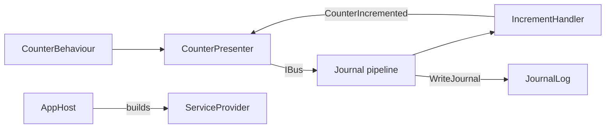

# vsa-consumer-unity

A Unity 6 project that uses the published VSA packages from [vsa-template](https://github.com/MgCohen/vsa-template). It has one module (`Counter`), one plugin module (`Journal`) and EditMode tests. It is the release check of VSA for Unity.

The module code is the same as in [vsa-consumer-dotnet](https://github.com/MgCohen/vsa-consumer-dotnet). Only the project files and the start of the host are different.

## What the project shows



| Part | Path | Shows |
|---|---|---|
| Composition | `Assets/App/AppComposition.cs` | `AddVsa`, with no host |
| App root | `Assets/App/AppHost.cs` | Builds the container with the scene, and disposes it |
| Unity console logs | `Assets/App/UnityLogProvider.cs` | An optional log provider that calls `Debug.Log` |
| VContainer | `Assets/App/VContainer/` | `builder.RegisterVsa(...)`: VContainer resolves the VSA services |
| Use of a module | `Assets/App/CounterBehaviour.cs` | A presenter in a `MonoBehaviour` |
| Module root | `Assets/Modules/Counter/CounterModule.cs` | Settings, services, repository |
| Plugin root | `Assets/Plugins/Journal/JournalPlugin.cs` | Settings, a custom pipeline |
| Tests | `Assets/Tests/EditMode/` | Domain tests, composition tests and VContainer tests |

## Start a project

1. Make a Unity 6 project.
2. Copy `vendor.cs`, `Vendor/VsaVendor.csproj` and `nuget.config` to the project root.
3. Set the token for GitHub Packages:
   ```bash
   export GITHUB_TOKEN=$(gh auth token)
   ```
4. Write the VSA DLLs to `Assets/Plugins/VSA`:
   ```bash
   dotnet run --file vendor.cs
   ```
5. Add a module: one folder for each layer, with one `.asmdef` in each folder. Use `Assets/Modules/Counter` as the model.
6. Add one `AppHost` component to the first scene.

## Use VSA as a dependency

Unity cannot restore NuGet packages, so git keeps the VSA DLLs. `vendor.cs` publishes `Vendor/VsaVendor.csproj` for `netstandard2.1` and copies the DLLs.

| File | VSA item |
|---|---|
| `Vendor/VsaVendor.csproj` | `VsaVersion` and the packages to vendor |
| `vendor.cs` | Writes `Assets/Plugins/VSA` |
| `Assets/Plugins/VSA/` | The VSA DLLs and their dependencies |
| `nuget.config` | The GitHub Packages feed, token from `GITHUB_TOKEN` |

Rules:

- Unity 6 ships some `Microsoft.Extensions` DLLs at version 8.0. `vendor.cs` does not copy them, and `VsaVendor.csproj` uses version 8.0.
- An `.asmdef` sets `overrideReferences`. A layer can use only the DLLs in its `precompiledReferences`.
- An assembly with a record has its own `IsExternalInit.cs`.

## Layers: one assembly definition for each layer

Unity does not run VSA.Sdk. Each `.asmdef` gives the references that VSA.Sdk gives in .NET.

| Assembly | References |
|---|---|
| `Counter.Domain` | `VSA.Domain` |
| `Counter.Infrastructure` | `Counter.Domain`, `VSA.Infrastructure` |
| `Counter.Contracts.Requests` | `Journal.Contracts.Requests`, `VSA.Contracts.Requests` |
| `Counter.Contracts.Events` | `VSA.Contracts.Events` |
| `Counter.Contracts.Commands` | `VSA.Contracts.Commands` |
| `Counter.Handlers.Requests` | Domain, contracts, `Journal.Handlers.Requests`, `VSA.Handlers.Requests` |
| `Counter.Handlers.Commands` | Domain, commands, `VSA.Handlers.Commands` |
| `Counter.Presenters` | Requests, events, `VSA.Presenters` |
| `Counter` (module root) | Each layer, `VSA.Module` |

A layer of a module gets the same layer of each plugin module, for example `Counter.Contracts.Requests` gets `Journal.Contracts.Requests`.

## Composition root

`AppComposition` builds the app. It is the Unity form of `Program.cs`. `AppHost` and the tests use it.

```csharp
public static IServiceCollection Compose(int counterMax) =>
    new ServiceCollection()
        .AddLogging(logging => logging.AddProvider(new UnityLogProvider()))
        .AddVsa($"--Modules:Counter:Max={counterMax}");

public static ServiceProvider Build(int counterMax) => Compose(counterMax).BuildServiceProvider();
```

A Unity app uses no host. Unity owns the process, so the app needs only the VSA registrations. `UnityLogProvider` is optional: with no provider, the logs go nowhere.

`AppScan` finds the module roots in the loaded assemblies. A module root is an assembly with one public class that inherits `Module` or `Plugin`. The layer assemblies of a module are the assemblies named `<Module>.<Layer>`, for example `Counter.Handlers.Requests`. A Unity module needs no records file.

### VContainer

`RegisterVsa` builds the Microsoft container and routes each VSA service to VContainer. A singleton comes from the root. A scoped or transient service comes from one VSA scope for each VContainer scope.

```csharp
public sealed class AppScope : LifetimeScope {
    [SerializeField] int counterMax = 5;

    protected override void Configure(IContainerBuilder builder) =>
        builder.RegisterVsa(AppComposition.Compose(counterMax));
}
```

The code is in the app, not in VSA, because VContainer is not on NuGet.

### Factories

A factory makes an object that the container cannot make, for example a Unity object from a prefab. Use `IFactory<T>` and `services.AddFactory(...)` from VSA.Composition. The factory gets the services. The object gets only what the factory gives it.

### A module root

```csharp
public sealed class CounterModule : Module<CounterSettings> {
    public override void Configure(ModuleBuilder module, CounterSettings settings) {
        module.Services.AddSingleton(new TallyStore(Tally.Create(TallyId.Main, settings.Max)));
        module.Services.AddScoped<IRepository<Tally, TallyId>, TallyRepository>();
    }
}
```

### A plugin root

```csharp
public sealed class JournalPlugin : Plugin<JournalSettings> {
    public override void Configure(ModuleBuilder module, JournalSettings settings) {
        module.Services.AddSingleton(new JournalLog(settings.MaxLines));
        module.Services.AddPipeline(new PipelineBuilder<Journaled>()
            .HandlersOf(typeof(RequestHandler<,>))
            .AfterStep<WriteJournal>());
    }
}
```

A request that derives from `Journaled` goes through this pipeline. `AddVsa` configures the plugin roots before the module roots.

### Settings

`AddVsa` binds `Modules:<Name>` to the settings of each root. `AppHost` gives the values as command line arguments from serialized fields. If a value is not valid, `AddVsa` stops with `Modules:Counter is not valid: ...`.

## Update VSA

1. Set `VsaVersion` in `Vendor/VsaVendor.csproj`.
2. Set `GITHUB_TOKEN`, then run `dotnet run --file vendor.cs`.
3. Run the tests. Commit the DLLs and their `.meta` files.

The `Vendor` workflow fails if `Assets/Plugins/VSA` does not match `VsaVersion`.

## Run the tests

Unity needs a license, so the tests run on a dev machine:

```bash
Unity.exe -batchmode -nographics -projectPath . -runTests -testPlatform EditMode -testResults TestResults-EditMode.xml -logFile -
```
