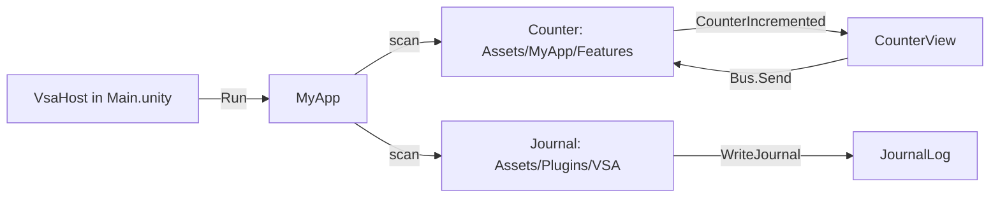

# vsa-consumer-unity

A Unity 6000.6 sample app that uses VSA from the UPM package `com.vsa.core` ([vsa-unity](https://github.com/MgCohen/vsa-unity)). It has one module in `Assets/` (`Counter`), one plugin module outside `Assets/` (`Journal`) and one uGUI view. It is the release check of VSA for Unity.

## Folders: the standard Unity layout at the repo root

```text
<repo root>/                          the app root: global.json, MyApp.slnx
  Packages/manifest.json              com.vsa.core by git URL
  Assets/
    Default.globalconfig              the VSA rule values (install step 1)
    csc.rsp                           C# 12 for Unity (the package writes it)
    MyApp/MyApp.cs                    the app class
    MyApp/link.xml                    the IL2CPP keep rules of the app
    MyApp/Features/Counter/           a module that Unity compiles (one asmdef)
    MyApp/Views/CounterView.cs        a uGUI view
    Plugins/VSA/                      the DLLs and PDBs of the modules in Source/ (committed)
    Scenes/Main.unity                 VsaHost and the view
    Tests/PlayMode/                   the Unity tests of the view and the app
    Il2cppCheck/                      the IL2CPP player check
  Source/                             the modules outside Assets/ (VSA.Sdk)
    Plugins/Journal/                  a plugin module, netstandard2.1
    MyApp.Tests/                      the .NET tests of all modules
```

## How the app starts



| Part | Path | Shows |
|---|---|---|
| Entry | `Assets/Scenes/Main.unity` | `VsaHost` with `--Modules:Counter:Max=5` |
| App class | `Assets/MyApp/MyApp.cs` | `MyApp : VsaApp<MyApp>` |
| Module in `Assets/` | `Assets/MyApp/Features/Counter/` | Slices, domain, infrastructure, presenter |
| Module outside `Assets/` | `Source/Plugins/Journal/` | A VSA.Sdk plugin with a custom pipeline |
| View | `Assets/MyApp/Views/CounterView.cs` | `PresenterComponent<CounterPresenter>` |

`VsaHost` finds the one app class and calls `Run`. The app has the lifetime of the Unity app. The app scan finds `Counter` (the `Counter` asmdef) and `Journal` (the DLLs in `Assets/Plugins/VSA/`).

## Install VSA in a Unity project

1. Copy [`Documentation~/Default.globalconfig`](https://github.com/MgCohen/vsa-unity/blob/v0.1.0-preview.26/Packages/com.vsa.core/Documentation~/Default.globalconfig) of the package to `Assets/Default.globalconfig`.
2. Add the package to `Packages/manifest.json`:
   ```json
   "com.vsa.core": "https://github.com/MgCohen/vsa-unity.git?path=/Packages/com.vsa.core#v0.1.0-preview.26"
   ```
3. Open the project. The package editor script writes `Assets/csc.rsp` (`-langversion:12`). Commit the file.
4. Put one `VsaHost` on a GameObject of the first scene.
5. Add one app class: `public sealed class MyApp : VsaApp<MyApp> { }`.

If you do step 2 before step 1, error VSA1000 stops the compile. The package README has the details.

## Modules

| Module place | Unity gets | .NET tests get |
|---|---|---|
| `Assets/MyApp/Features/` or `Plugins/` | The sources, one asmdef for each module | The same sources, compiled by `MyApp.Tests` |
| `Source/Features/` or `Plugins/` | The DLL and PDB in `Assets/Plugins/VSA/` | A project reference |

### A module in `Assets/`

- Give the module one asmdef with the name of the module, for example `Counter`. The module name is the assembly name.
- Set `noEngineReferences` to `true`. Module code does not use `UnityEngine` (VSA0008 in the .NET build).
- Put `IsExternalInit.cs` in the module for records (`#if !NET`).
- Give each request `Method` and `Route`. The net10.0 build of the .NET tests needs them (`IRoutedRequest`).

### A module outside `Assets/`

1. Put the module project in `Source/Features/<Name>/` or `Source/Plugins/<Name>/`.
2. Target `netstandard2.1` (see `Source/Plugins/Directory.Build.props`).
3. Build it. VSA.Sdk copies each DLL and PDB to `Assets/Plugins/VSA/`.
4. Commit the DLLs, the PDBs and their `.meta` files.

```bash
export GITHUB_TOKEN=$(gh auth token)
dotnet build Source/Plugins/Journal/Journal.csproj
```

`nuget.config` reads the VSA packages from GitHub Packages with `GITHUB_TOKEN`.

## Views

```csharp
namespace MyApp.Views
{
    public sealed class CounterView : PresenterComponent<CounterPresenter>
    {
        protected override void Render()
        {
            label.text = $"{Presenter.Value} of {Presenter.Max}";
        }
    }
}
```

- The base gets the presenter from a new scope of the running app, and calls `Render` on each change.
- Write a MonoBehaviour in a block namespace. In Unity 6000.6.6f1, a MonoBehaviour in a file-scoped namespace has no script class, so the scene shows a missing script.
- The VSA rules (VSA1xxx) run on each asmdef that references `VSA.Unity`. VSA1013 permits no comments in the code.

## Tests and checks

| Check | Command | Tests |
|---|---|---|
| Module tests | `dotnet test --solution MyApp.slnx` | Domain and handlers of all modules |
| Unity tests | `./run-tests.ps1` | The view and the app in play mode |
| IL2CPP check | `./il2cpp-check.ps1` | The Windows IL2CPP player, stripping High |

- The module tests need `GITHUB_TOKEN`. The `dotnet` workflow runs them on each PR.
- The Unity tests and the IL2CPP check need a Unity license, so they run on a dev machine.
- The IL2CPP player runs `Assets/Il2cppCheck/PlayerCheck.cs` only with the `-vsaCheck` argument.

### IL2CPP keep rules

`Assets/MyApp/link.xml` keeps three items for the UnityLinker (managed stripping High):

| Kept | Reason |
|---|---|
| The `Journal` assembly | No assembly references a plugin root DLL |
| The `Journal.Handlers.Requests` assembly | Only `ActivatorUtilities` makes the `WriteJournal` step |
| `Counter.CounterSettings` | Only the configuration binder calls the setters |

If an item is not kept, the player has no `Journal` module, no journal lines, or the default `Max`.

## Update VSA

1. Set the tag in `Packages/manifest.json` and the version of `VSA.Sdk` in `global.json`.
2. Copy the new `Default.globalconfig` of the package, or let the editor script update its block.
3. Build each module project in `Source/`, then commit the DLLs in `Assets/Plugins/VSA/`.
4. Run the three checks.

## Open questions

- `MyApp.Tests.csproj` references `VSA.Presenters` itself. VSA.Sdk 0.1.0-preview.26 does not add the layer packages to a `.Tests` project of a Unity app.
- `IRoutedRequest`: a request in `Assets/` needs `Method` and `Route` only for the .NET tests.
- Keep rules: `com.vsa.core` 0.1.0-preview.26 does not keep the module root assemblies, the pipeline steps and the settings classes.
